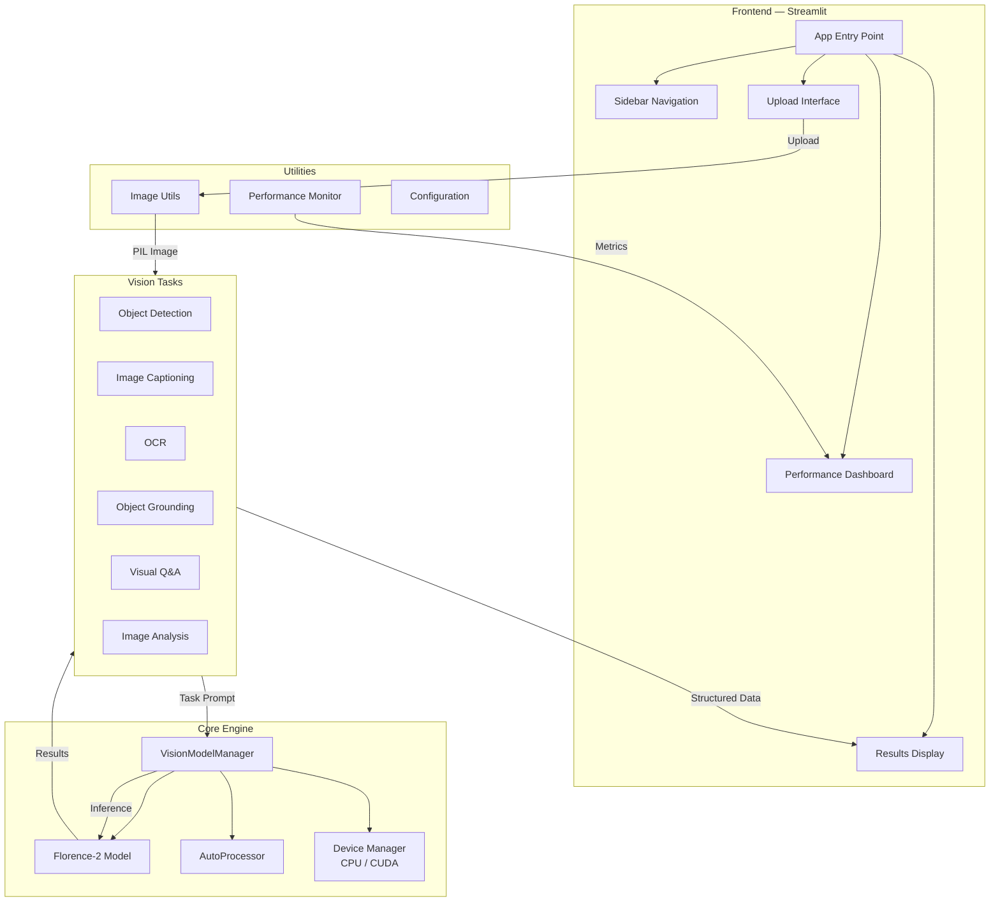
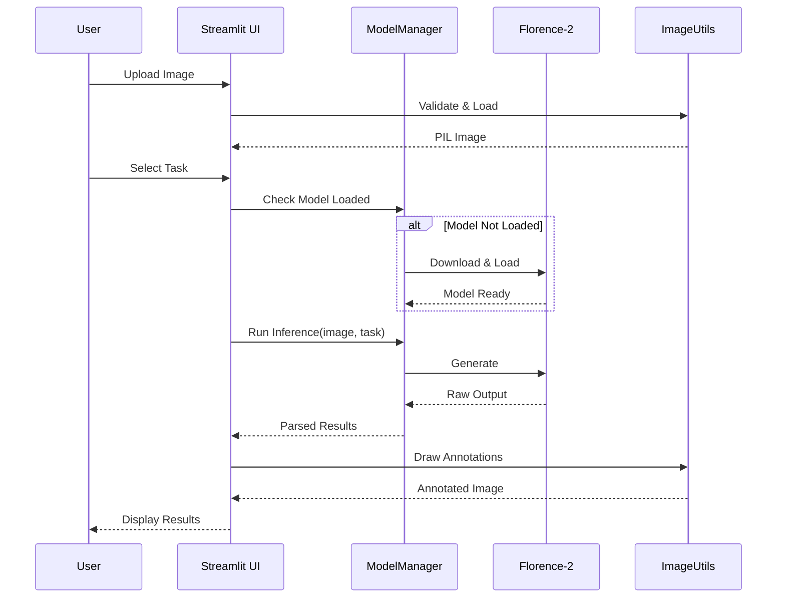

# 🔮 On-Device Vision AI — Intelligent Image Analyzer

<div align="center">


**Intelligent Computer Vision • Private • Local • Efficient**

*A production-grade, on-device computer vision application powered by Microsoft Florence-2. All image processing happens locally — no images are ever sent to external APIs.*

[Features](#-key-features) · [Architecture](#-architecture) · [Installation](#-installation) · [Usage](#-usage) · [Screenshots](#-screenshots) · [Contributing](#-contributing)

</div>

---

## 📋 Table of Contents

- [Problem Statement](#-problem-statement)
- [Project Objectives](#-project-objectives)
- [Key Features](#-key-features)
- [Technology Stack](#-technology-stack)
- [Architecture](#-architecture)
- [Project Structure](#-project-structure)
- [Installation](#-installation)
- [Model Download](#-model-download)
- [Usage](#-usage)
- [Computer Vision Tasks](#-computer-vision-tasks)
- [CPU / GPU Compatibility](#-cpu--gpu-compatibility)
- [Performance Optimization](#-performance-optimization)
- [Offline Capabilities](#-offline-capabilities)
- [Privacy & Security](#-privacy--security)
- [Testing](#-testing)
- [Screenshots](#-screenshots)
- [Future Enhancements](#-future-enhancements)

---

## 🎯 Problem Statement

Cloud-based AI services raise privacy concerns — uploaded images may be stored, analyzed, or used for training by third-party providers. Many users and organizations need intelligent image analysis capabilities while keeping their data entirely on-premises.

**On-Device Vision AI** solves this by running state-of-the-art computer vision models locally, ensuring zero data leaves the user's machine during inference.

---

## 🎯 Project Objectives

1. Build a **complete, production-quality** computer vision application
2. Use **Microsoft Florence-2** for multi-task vision intelligence
3. Run **100% local inference** — no external API calls
4. Support **multiple CV tasks**: detection, captioning, OCR, grounding, VQA
5. Deliver a **modern, polished UI** suitable for portfolio demonstration
6. Optimize for **both CPU and GPU** environments
7. Provide **real-time performance monitoring** and benchmarks

---

## ✨ Key Features

| Feature | Description |
|---------|-------------|
| 🔍 **Object Detection** | Detect and locate multiple objects with labeled bounding boxes |
| 📝 **Image Captioning** | Generate natural-language descriptions at multiple detail levels |
| 📄 **OCR** | Extract text from images — signs, documents, screenshots |
| 🎯 **Object Grounding** | Locate specific objects by name within an image |
| ❓ **Visual Q&A** | Ask natural-language questions about image content |
| 📊 **Image Analysis** | Combined statistics — object counts, categories, metadata |
| ⚡ **Performance Monitor** | Real-time inference benchmarks and hardware monitoring |
| 🔒 **100% Private** | All processing happens on your machine — zero data transmitted |
| 🌐 **Offline Ready** | Works without internet after initial model download |
| 💻 **CPU + GPU** | Automatic hardware detection with optimized inference |

---

## 🛠️ Technology Stack

| Category | Technology |
|----------|-----------|
| **Language** | Python 3.11+ |
| **AI Framework** | PyTorch, Hugging Face Transformers |
| **Vision Model** | Microsoft Florence-2 (`florence-community/Florence-2-base`) |
| **Frontend** | Streamlit with custom CSS |
| **Image Processing** | Pillow, NumPy |
| **Performance** | CUDA (optional), FP16 precision, model caching |
| **Testing** | Pytest |

---

## 🏗️ Architecture



### Application Workflow



---

## 📁 Project Structure

```
OnDeviceVisionAI/
│
├── app.py                  # Main Streamlit application
├── config.py               # Configuration and constants
├── model.py                # Florence-2 model manager
├── vision_tasks.py         # Computer vision task functions
├── image_utils.py          # Image processing utilities
├── performance.py          # Performance monitoring
├── requirements.txt        # Python dependencies
├── README.md               # Documentation
├── .gitignore              # Git ignore rules
├── .env.example            # Environment variable template
│
├── components/             # UI components
│   ├── __init__.py
│   ├── sidebar.py          # Sidebar navigation
│   ├── upload.py           # Image upload interface
│   ├── results.py          # Result display components
│   ├── dashboard.py        # Dashboard header & about page
│   └── styles.py           # Custom CSS styling
│
├── tests/                  # Test suite
│   ├── __init__.py
│   ├── test_config.py      # Configuration tests
│   ├── test_image_utils.py # Image utility tests
│   └── test_vision_tasks.py# Vision task tests
│
├── assets/                 # Static assets
│   ├── logo.png
│   └── sample_images/
│
├── outputs/                # Generated output images
│   └── .gitkeep
│
└── screenshots/            # Application screenshots
    └── .gitkeep
```

---

## 🚀 Installation

### Prerequisites

- **Python 3.11+** — [Download Python](https://www.python.org/downloads/)
- **Git** — [Download Git](https://git-scm.com/downloads)
- **~1 GB free disk space** for model weights
- **(Optional) NVIDIA GPU** with CUDA for accelerated inference

### Step 1: Clone the Repository

```powershell
git clone https://github.com/YOUR_USERNAME/on-device-vision-ai.git
cd on-device-vision-ai
```

### Step 2: Create Virtual Environment

```powershell
python -m venv venv
.\venv\Scripts\Activate.ps1
```

### Step 3: Install Dependencies

**For CPU-only:**
```powershell
pip install torch torchvision --index-url https://download.pytorch.org/whl/cpu
pip install -r requirements.txt
```

**For CUDA GPU (NVIDIA):**
```powershell
pip install torch torchvision --index-url https://download.pytorch.org/whl/cu121
pip install -r requirements.txt
```

### Step 4: (Optional) Configure Environment

```powershell
Copy-Item .env.example .env
# Edit .env to customize settings
```

---

## 📥 Model Download

The application uses **Microsoft Florence-2** (`florence-community/Florence-2-base`).

On first launch, the model weights (~500 MB) are automatically downloaded from Hugging Face and cached locally.

**Manual pre-download:**
```powershell
python -c "from transformers import AutoModelForCausalLM, AutoProcessor; AutoProcessor.from_pretrained('florence-community/Florence-2-base', trust_remote_code=True); AutoModelForCausalLM.from_pretrained('florence-community/Florence-2-base', trust_remote_code=True)"
```

After download, the model is cached at `~/.cache/huggingface/` and **no further internet access is required**.

---

## ▶️ Usage

### Launch the Application

```powershell
streamlit run app.py
```

The application opens in your browser at `http://localhost:8501`.

### Quick Start

1. **Select a task** from the sidebar (Object Detection, Captioning, OCR, etc.)
2. **Upload an image** (JPG, PNG, or WEBP)
3. **Click the action button** to run inference
4. **View results** — annotated images, captions, extracted text
5. **Download** annotated images or copy text outputs

---

## 🧠 Computer Vision Tasks

### 🔍 Object Detection

Detects multiple objects and draws labeled bounding boxes.

- **Task prompt:** `<OD>`
- **Output:** Object labels, bounding box coordinates, annotated image
- **Download:** Annotated image with bounding boxes

### 📝 Image Captioning

Generates natural-language descriptions at three detail levels:

| Level | Task Prompt | Description |
|-------|------------|-------------|
| Normal | `<CAPTION>` | Brief one-sentence description |
| Detailed | `<DETAILED_CAPTION>` | Multi-sentence description |
| More Detailed | `<MORE_DETAILED_CAPTION>` | Comprehensive description |

### 📄 OCR (Optical Character Recognition)

Extracts text from images containing signs, documents, handwriting, or screenshots.

- **Task prompt:** `<OCR>`
- **Output:** Extracted text string
- **Handles:** Images with no detectable text

### 🎯 Object Grounding

Locates specific objects by name within an image.

- **Task prompt:** `<CAPTION_TO_PHRASE_GROUNDING>`
- **Input:** Object name (e.g., "person", "car", "dog")
- **Output:** Bounding boxes around matching objects

### ❓ Visual Question Answering

Ask questions about image content. Uses Florence-2's detailed captioning and dense region analysis.

> [!NOTE]
> Florence-2-base does not natively support open-ended VQA. This feature uses detailed captioning + dense region captions to provide image analysis in response to questions. For full VQA capabilities, consider using a dedicated VQA model (see [Future Enhancements](#-future-enhancements)).

### 📊 Image Analysis

Combined analysis providing:
- Object detection counts by category
- Image description
- Image metadata (dimensions, format, file size)
- Processing time and inference device

---

## 💻 CPU / GPU Compatibility

| Hardware | Support | Precision | Performance |
|----------|---------|-----------|-------------|
| **CPU** | ✅ Full | FP32 | ~2-5s per image |
| **NVIDIA GPU (CUDA)** | ✅ Full | FP16 | ~0.2-1s per image |
| **AMD GPU (ROCm)** | ⚠️ Experimental | FP32 | Varies |
| **Apple Silicon (MPS)** | ⚠️ Experimental | FP32 | Varies |

The application automatically detects available hardware and selects the optimal device.

---

## ⚡ Performance Optimization

- **Model Caching:** Florence-2 is loaded once and cached for the session
- **Inference Mode:** Uses `torch.inference_mode()` for faster inference
- **FP16 Precision:** Automatic half-precision on CUDA devices
- **Lazy Loading:** Model loads only when first needed
- **Image Preprocessing:** Memory-aware resizing for large images
- **Session Persistence:** Results cached within Streamlit session

---

## 🌐 Offline Capabilities

| Component | Internet Required? |
|-----------|-------------------|
| Initial model download | ✅ Yes (one-time, ~500 MB) |
| Dependency installation | ✅ Yes (one-time) |
| Image inference | ❌ No — fully offline |
| All CV tasks | ❌ No — fully offline |
| Results display | ❌ No — fully offline |

> [!IMPORTANT]
> After the initial setup, the application runs **completely offline**. No images, queries, or results are transmitted to any external service.

---

## 🔒 Privacy & Security

- **Zero data transmission:** All inference runs locally on your machine
- **No telemetry:** The application does not collect or send usage data
- **No persistent storage:** Uploaded images are not saved by default
- **Optional output saving:** Download annotated images only when you choose
- **No external API calls:** No OpenAI, Gemini, Groq, or cloud inference

---

## 🧪 Testing

Run the full test suite:

```powershell
pytest -v
```

Run specific test files:

```powershell
pytest tests/test_config.py -v
pytest tests/test_image_utils.py -v
pytest tests/test_vision_tasks.py -v
```

> [!NOTE]
> Tests use mocking for model inference — **no GPU or model download required** to run the test suite.

---

## 📸 Screenshots

> *Screenshots will be added after the application is running. Use the `screenshots/` directory.*

| Screen | Description |
|--------|-------------|
| Dashboard | *screenshot placeholder* |
| Object Detection | *screenshot placeholder* |
| Image Captioning | *screenshot placeholder* |
| OCR Results | *screenshot placeholder* |
| Object Grounding | *screenshot placeholder* |
| Performance Monitor | *screenshot placeholder* |

---

## 🔮 Future Enhancements

- [ ] **Dedicated VQA model** — Integrate BLIP-2 or LLaVA for open-ended visual Q&A
- [ ] **Batch processing** — Analyze multiple images at once
- [ ] **Video analysis** — Frame-by-frame object detection on video files
- [ ] **Image segmentation** — Pixel-level object segmentation
- [ ] **Model comparison** — Side-by-side results from different model sizes
- [ ] **Export formats** — JSON, CSV export for detection results
- [ ] **API mode** — FastAPI backend for programmatic access
- [ ] **Docker support** — Containerized deployment
- [ ] **Custom model fine-tuning** — Fine-tune Florence-2 on domain-specific data
- [ ] **Real-time webcam** — Live camera feed analysis

---


